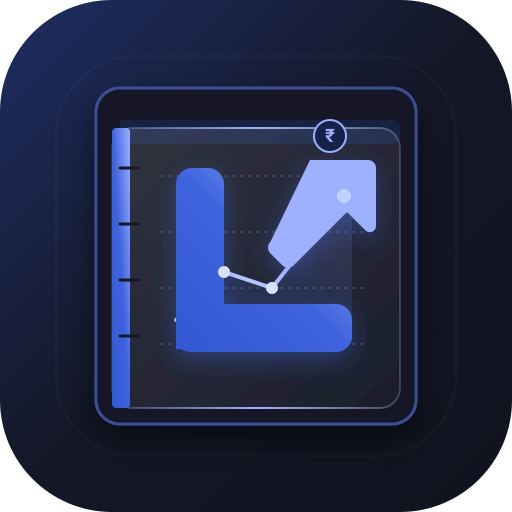
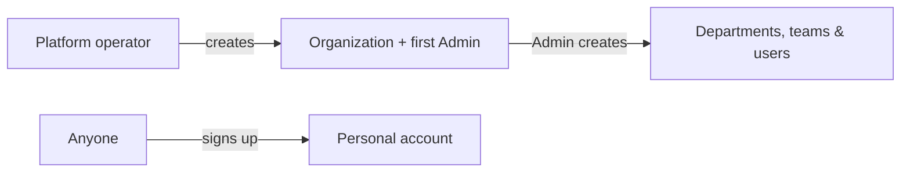
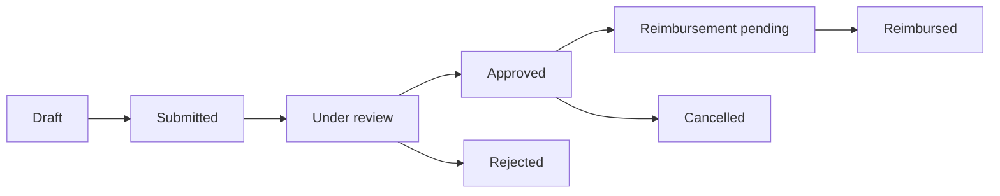
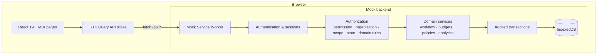

<div align="center">



# Ledgerly

**Expense management and spending insight for organizations, individuals, and the people who run the platform.**

Submit an expense, route it to the right approver, reimburse it, and see where the money went, with every action authorized and audited.


[](https://ledgerly-expense-management.netlify.app/)

### [🚀 Live demo: ledgerly-expense-management.netlify.app](https://ledgerly-expense-management.netlify.app/)

Sign in with any of the [demo accounts](#demo-accounts). Your data stays in your own browser.

[Highlights](#highlights) · [Account types](#three-account-types) · [Features](#features) · [Architecture](#architecture) · [Getting started](#getting-started) · [Demo accounts](#demo-accounts)

</div>

---

## Highlights

- **Three isolated account types.** Organization, personal, and platform accounts each get their own routes, navigation, and data, and the API enforces those boundaries.
- **Real approval workflow.** An approval matrix routes each expense by its owner's role, and expenses above a policy threshold move one level up.
- **Resource-level authorization.** Each request is checked for permission, organization, scope (own, team, department, or organization), record state, and domain rules. The UI only hides what the API already refuses.
- **Four-level budgets.** Budgets are allocated by organization, department, team, and expense type, with activate, close, reopen, and rollover. Utilization is calculated from reimbursed spending.
- **Full audit trail.** Every change is recorded with field-level before and after values. Admins get an Audit log and every user gets their own Activity page.
- **A complete backend that runs in the browser.** Mock Service Worker and IndexedDB run every endpoint, with PBKDF2-SHA256 password hashing, sessions, versioned database migrations, and transactional writes. No server is needed to run it.

## Three account types

| Account | Who it's for | What they do | Home |
| --- | --- | --- | --- |
| **Organization** | Employees, managers, Finance, Admins | Expenses, approvals, reimbursements, budgets, policies, analytics, administration | `/dashboard` |
| **Personal** | Individuals | Personal expenses, receipts, monthly budgets, spending analytics | `/personal/dashboard` |
| **Platform** | Ledgerly operators | Create organizations and each one's first Admin | `/platform/organizations` |



Personal users sign up themselves. Organization users are created by their organization's Admin. Organizations are created by platform operators. Each type of account is refused by the other areas and redirected to its own home.

## Features

### Organization workspace

**Expenses**
- Create, edit, and submit expenses with a required expense type and receipts
- Draft expenses are visible only to their owner
- Expense lists by scope: *My*, *Team*, *Department*, and *Organization* expenses, depending on role

**Approvals and reimbursements**



| Expense owner | Reviewed by |
| --- | --- |
| Employee | Their team's manager, or Admin |
| Manager | Finance authorized for the department, or Admin |
| Finance | Admin only |
| Admin | Admin |

- Expenses above a policy's threshold go one level up the chain
- Approval and reimbursement are kept separate: whoever approves an escalated expense can't also reimburse it
- The Approvals workspace has separate *Review* and *Reimbursement* queues

**Policies**
- Spending rules by expense type and department, with approval thresholds
- Previewed while you fill in an expense, enforced on submit, and used to route approvals
- A policy simulator tests a hypothetical expense against the rules

**Budgets**
- Organization → department → team → expense-type allocations
- Budget periods with activate, close, reopen, and rollover
- Expenses can only be created while a budget is active for the current period
- Titles adapt to the viewer's role, for example "Engineering Department Budget" for Finance

**Analytics and dashboard**
- KPIs, spending trends, expense-type breakdowns, and budget utilization with MUI X Charts
- Data is limited to what the viewer is authorized to see

**Administration**
- Users with soft removal, roles with granular permissions, departments, teams, and Finance department assignments
- One manager per team, and every user must belong to a team
- Audit log with per-event detail

**Everyday tools**
- A notification bell built from audit events and work queues
- *My Team* and *My Department* pages showing who reviews your expenses
- Self-service profile, password change, and "sign out of other sessions"

### Personal finance

- A personal dashboard with the monthly summary, budget status, and recent transactions
- Expenses with type, payment method, search, filters, date ranges, and pagination
- Receipt attachments (JPG, PNG, or PDF, up to 5 MB, five per expense)
- Monthly budgets with optional limits per expense type
- Spending analytics over up to 36 months

### Platform administration

- Every organization, with its Admins, number of users, and status
- One-step creation of an organization with its own system roles, a default `General` department and team, and its first Admin
- Platform operators can't see any organization's data

### Across the app

- Light and dark themes from one centralized MUI theme
- Per-user settings, including theme, start page, and notification categories
- A confirmation step before every change
- Responsive layout from phone to desktop

## Architecture



- **Feature-based structure.** Each domain owns its API slice, types, components, and pages, and features don't reach into each other's internals.
- **A replaceable backend.** The UI only talks to `/api/*` through RTK Query. Swapping MSW for a real server changes no UI code.
- **Authorization lives in the backend.** Route guards and hidden buttons improve the experience, but every decision is made by the API.
- **Derived data is never stored.** Dashboards, analytics, budget utilization, and notifications are calculated from transactional records.

<details>
<summary><strong>Project structure</strong></summary>

```text
src/
├── app/                 # Providers and app setup
├── components/          # Shared UI and navigation
├── features/
│   ├── auth/            # Sign-in, sessions, account types
│   ├── expenses/        # Organization expenses
│   ├── approvals/       # Review workspace
│   ├── reimbursements/  # Reimbursement processing
│   ├── budgets/         # Four-level budgets
│   ├── policies/        # Spending rules and simulator
│   ├── analytics/       # Organization analytics
│   ├── dashboard/       # Organization dashboard
│   ├── users/           # User management
│   ├── roles/           # Roles and permissions
│   ├── organizations/   # Departments, teams, membership
│   ├── platform/        # Platform administration
│   ├── personal/        # Personal finance
│   ├── audit/           # Audit log
│   ├── activity/        # Per-user activity
│   ├── notifications/   # Notification bell
│   ├── documents/       # Receipts
│   ├── settings/        # User preferences
│   └── userProfile/     # Profile and Account hub
├── layouts/             # App and auth layouts
├── mocks/               # MSW handlers, services, IndexedDB, seed data
├── pages/               # Landing page and app-level pages
├── routes/              # Router and guards
├── services/            # API base, cookies, query helpers
├── store/               # Redux store
├── theme/               # MUI theme (light/dark)
├── types/               # Shared types
└── utils/               # Formatting helpers
```

</details>

## Tech stack

| Area | Tools |
| --- | --- |
| UI | React 19, Material UI 9, MUI X Charts, Emotion |
| State and data | Redux Toolkit, RTK Query |
| Routing | React Router 7 (lazy-loaded routes) |
| Mock backend | Mock Service Worker 2, IndexedDB, Web Crypto (PBKDF2) |
| Tooling | Vite 8, TypeScript 6, React Compiler, Oxlint |
| Hosting | Netlify |

## Getting started

**Prerequisites:** Node.js 24 or later, and npm.

```bash
git clone https://github.com/Shreyas262/Ledgerly.git
cd Ledgerly
npm install
npm run dev
```

Open the URL Vite prints (usually `http://localhost:5173`). The mock backend starts automatically and seeds its demo data on first load.

| Script | Purpose |
| --- | --- |
| `npm run dev` | Start the development server with the mock API |
| `npm run build` | Type-check and build for production |
| `npm run preview` | Serve the production build locally |
| `npm run lint` | Lint with Oxlint |

> **Production builds and the mock API:** the mock API always runs in development. In a production build it runs only when `VITE_ENABLE_MOCKS=true` is set at build time:
>
> ```bash
> VITE_ENABLE_MOCKS=true npm run build && npm run preview
> ```

### Deploying to Netlify

[`netlify.toml`](netlify.toml) contains everything Netlify needs: the build command, the `dist` publish folder, Node 24, the mock API flag, and a rewrite so React Router routes like `/expenses` don't return 404 on refresh. Import the repository in Netlify and deploy without changing any settings.

Your data lives in your own browser (IndexedDB), so every visitor gets their own sandbox.

## Demo accounts

| Account | Email | Password | Sign in at |
| --- | --- | --- | --- |
| Employee | `employee@ledgerly.com` | `employee123` | `/auth/login` |
| Manager | `manager@ledgerly.com` | `manager123` | `/auth/login` |
| Finance | `finance@ledgerly.com` | `finance123` | `/auth/login` |
| Admin | `admin@ledgerly.com` | `admin123` | `/auth/login` |
| Personal | `personal@ledgerly.com` | `personal123` | `/auth/login?type=personal` |
| Platform | `platform@ledgerly.com` | `platform123` | `/auth/login?type=platform` |

**Things to try:**
1. As **Admin**, create and activate a budget. Expenses can't be created until one is active.
2. As **Employee**, submit an expense, then approve it as **Manager** and reimburse it as **Finance**.
3. As **Platform**, create a new organization, then sign in as its Admin and set it up from scratch.
4. Check the **Audit log** as Admin to see every step you just took.

## Routes

| Area | Routes |
| --- | --- |
| Public | `/`, `/auth/login`, `/auth/register` |
| Organization | `/dashboard`, `/expenses`, `/approvals`, `/budgets`, `/analytics`, `/policies`, `/users`, `/roles`, `/admin`, `/admin/organization`, `/audit`, `/account/team` |
| Personal | `/personal/dashboard`, `/personal/expenses`, `/personal/budgets`, `/personal/analytics` |
| Platform | `/platform/organizations` |
| Every account | `/account`, `/profile`, `/activity`, `/settings` |

---

<div align="center">

Built with React, TypeScript and a lot of attention to authorization.

</div>
